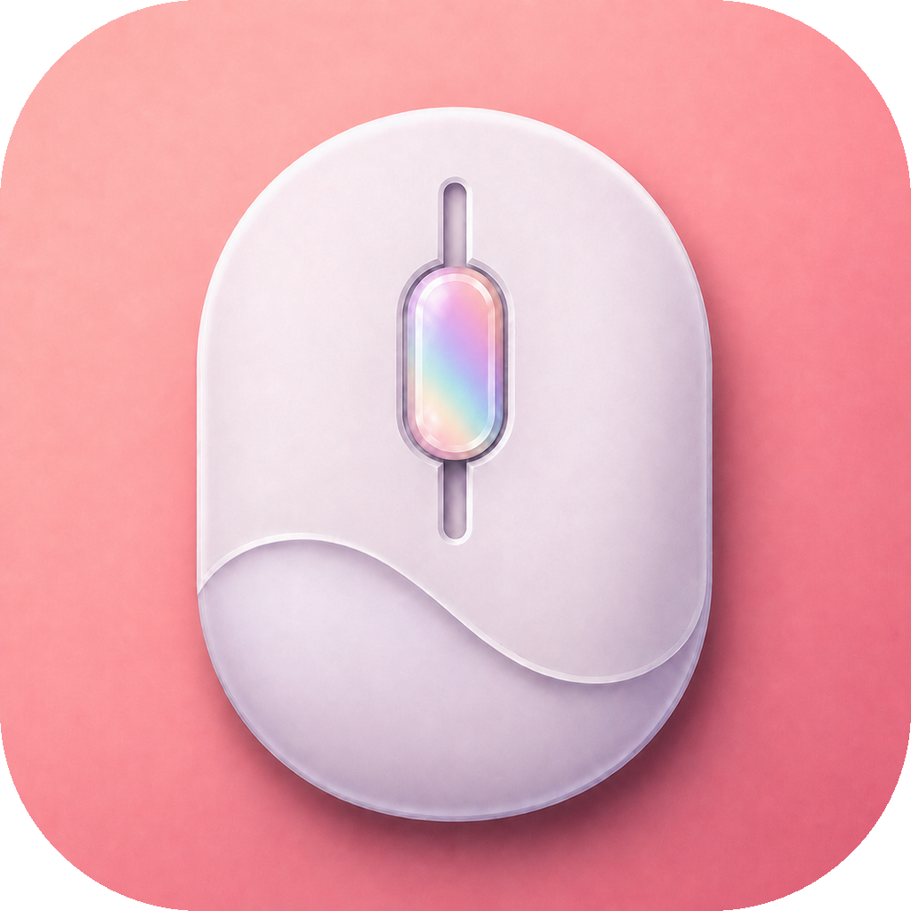

<!-- SPDX-License-Identifier: CC-BY-SA-4.0 -->

<p align="center">
  
</p>

<h1 align="center">Mira</h1>

<p align="center">
  A cross-platform mouse configurator for DPI, polling rate, lighting, and battery status.<br>
  Available on macOS, Windows, and Linux. Device settings stay local; no account or cloud service required.
</p>

<p align="center">
  <a href="https://github.com/hello-yunshu/mira-mouse/releases/latest"></a>
  
  
</p>

<p align="center">
  <a href="https://github.com/hello-yunshu/mira-mouse/releases/latest">Download latest</a> ·
  <a href="https://github.com/hello-yunshu/mira-mouse/issues">Report an issue</a> ·
  <a href="README.md">简体中文</a>
</p>

---

## Features

| Capability | What it does |
|---|---|
| DPI and polling rate | Adjust supported stages and save settings per profile |
| Lighting and night mode | Configure RGB effects and schedule lights to turn off or restore using local time |
| Battery status | Check mouse and receiver charge at a glance from the tray icon |
| Multiple devices | Connect multiple devices and keep their settings separate |
| Local battery prediction | Estimate battery life from DPI, polling rate, and lighting settings |
| Plugin-based device support | Add devices through independently signed plugins, without updating the host app for every mouse |

## Supported devices

| Brand | Connections |
|---|---|
| AMaster / Angry Miao | Direct USB or 2.4 GHz receiver |
| Logitech | Direct USB or 2.4 GHz receiver |

Support varies by model and connection type. Bluetooth is not currently supported. Mira is not authorized or sponsored by device manufacturers; their names are used only to describe compatibility.

Request support for a device in [GitHub Issues](https://github.com/hello-yunshu/mira-mouse/issues), or see the [Plugin SDK](docs/plugin-sdk.md).

## Download and install

Open the [latest release](https://github.com/hello-yunshu/mira-mouse/releases/latest) and choose the package for your system:

| System | Package |
|---|---|
| macOS (Apple Silicon) | [Download DMG](https://github.com/hello-yunshu/mira-mouse/releases/latest/download/Mira_macOS_1.2.12_aarch64.dmg) |
| Windows (x64) | [Download installer](https://github.com/hello-yunshu/mira-mouse/releases/latest/download/Mira_Windows_1.2.12_x64-setup.exe) |
| Linux (x86_64) | [Download AppImage](https://github.com/hello-yunshu/mira-mouse/releases/latest/download/Mira_Linux_1.2.12_amd64.AppImage) |

On macOS, you can also install with Homebrew:

```bash
brew tap hello-yunshu/mira
brew trust hello-yunshu/mira
brew install --cask mira
```

On first launch, Gatekeeper may say the developer cannot be verified. See the [macOS install guide](docs/install-macos.md) and [security notes](docs/unsigned-release-security.md) for installation and permission steps.

## FAQ

<details>
<summary>Does Mira require an account or an internet connection?</summary>

No account or cloud service is required. Mira does not collect telemetry. Network access is used only to check for updates and download apps, plugins, or local-AI components you choose.

</details>

<details>
<summary>Why does my device show as occupied?</summary>

A vendor configuration tool may already be using the mouse. Quit tools such as AMasterLauncher, Logi Options+, or G HUB, then try again.

</details>

<details>
<summary>What if my device is not listed?</summary>

Compatibility depends on the exact model and connection. Search [GitHub Issues](https://github.com/hello-yunshu/mira-mouse/issues) for your model, or open a device-support request if you do not find one.

</details>

## Development and contributing

```bash
git clone https://github.com/hello-yunshu/mira-mouse.git
cd mira-mouse
npm install
npm run sidecar:build
npm run dev
```

For a desktop preview, run `npm exec tauri dev`. See [CONTRIBUTING.md](CONTRIBUTING.md) for the full development and contribution guide.

## Documentation

[Changelog](CHANGELOG.md) · [Roadmap](ROADMAP.md) · [Support](SUPPORT.md) · [Plugin SDK](docs/plugin-sdk.md) · [Protocol guide](docs/protocol-dsl.md) · [Plugin security](docs/plugin-security.md) · [Windows install](docs/install-windows.md) · [Linux permissions](docs/linux-permissions.md)

## License

Code is licensed under AGPL-3.0-or-later. Original documentation and non-trademark visual materials are licensed under CC-BY-SA-4.0. See [LICENSE](LICENSE), [NOTICE](NOTICE), and the [license notes](docs/license-notes.md). The Mira name and logo are covered by [TRADEMARKS.md](TRADEMARKS.md).
