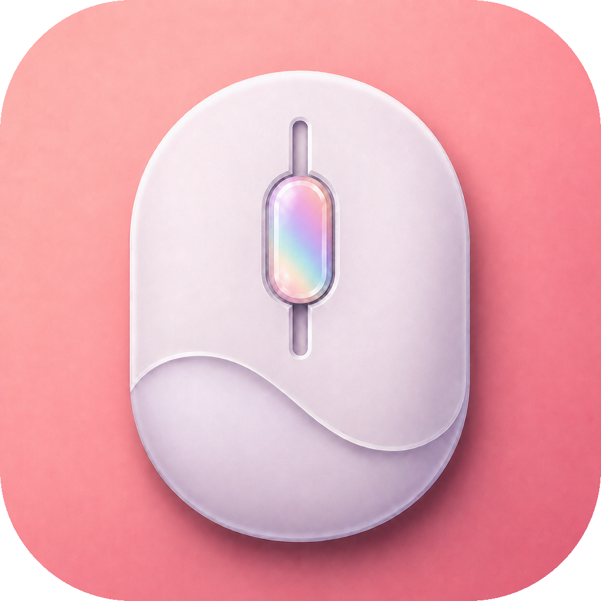

<!-- SPDX-License-Identifier: CC-BY-SA-4.0 -->

<p align="center">
  
</p>

<h1 align="center">Mira</h1>

<p align="center">
  跨平台鼠标设置工具，用一个应用管理 DPI、回报率、灯光与电池状态。<br>
  支持 macOS、Windows 和 Linux；设备设置在本地处理，无需账号或云端服务。
</p>

<p align="center">
  <a href="https://github.com/hello-yunshu/mira-mouse/releases/latest"></a>
  
  
</p>

<p align="center">
  <a href="https://github.com/hello-yunshu/mira-mouse/releases/latest">下载最新版</a> ·
  <a href="https://github.com/hello-yunshu/mira-mouse/issues">反馈问题</a> ·
  <a href="README.en.md">English</a>
</p>

---

## 功能

| 能力 | 说明 |
|---|---|
| DPI 与回报率 | 调整设备支持的档位，并按配置分别保存 |
| 灯光与夜间模式 | 调节 RGB 灯效，并按本地时间自动关闭或恢复灯光 |
| 电池状态 | 查看鼠标与接收器电量，通过托盘图标快速了解状态 |
| 多设备管理 | 同时连接多台设备，分别保存设置 |
| 本地续航预测 | 根据 DPI、回报率和灯光设置估算电池续航 |
| 插件式设备支持 | 通过独立签名插件扩展设备，无需为每款鼠标更新主应用 |

## 支持设备

| 品牌 | 连接方式 |
|---|---|
| AMaster / 怒喵 | USB 直连 / 2.4 GHz 接收器 |
| Logitech | USB 直连 / 2.4 GHz 接收器 |

支持情况因具体型号和连接方式而异。目前不支持蓝牙。Mira 未获设备厂商授权或赞助；厂商名称仅用于说明兼容性。

想申请支持新设备？请提交[设备支持请求](https://github.com/hello-yunshu/mira-mouse/issues)，或查看[插件 SDK](docs/plugin-sdk.md)。

## 下载与安装

前往[最新版发布页](https://github.com/hello-yunshu/mira-mouse/releases/latest)，选择与你的系统对应的文件：

| 系统 | 安装包 |
|---|---|
| macOS（Apple Silicon） | [下载 DMG](https://github.com/hello-yunshu/mira-mouse/releases/latest/download/Mira_macOS_1.2.12_aarch64.dmg) |
| Windows（x64） | [下载安装程序](https://github.com/hello-yunshu/mira-mouse/releases/latest/download/Mira_Windows_1.2.12_x64-setup.exe) |
| Linux（x86_64） | [下载 AppImage](https://github.com/hello-yunshu/mira-mouse/releases/latest/download/Mira_Linux_1.2.12_amd64.AppImage) |

macOS 也可通过 Homebrew 安装：

```bash
brew tap hello-yunshu/mira
brew trust hello-yunshu/mira
brew install --cask mira
```

首次在 macOS 打开时，Gatekeeper 可能提示无法验证开发者。安装方式、权限和处理步骤见[macOS 安装说明](docs/install-macos.md)与[安全说明](docs/unsigned-release-security.md)。

## 常见问题

<details>
<summary>需要账号或联网使用吗？</summary>

不需要账号或云端服务。Mira 不采集遥测；联网仅用于检查更新，以及下载你选择的应用、插件或本地 AI 组件。

</details>

<details>
<summary>为什么设备显示为占用？</summary>

设备厂商的配置软件可能正在使用鼠标。请先退出 AMasterLauncher、Logi Options+、G HUB 等工具，再重试。

</details>

<details>
<summary>设备不在列表里怎么办？</summary>

连接方式和具体型号会影响兼容性。请先在 [Issues](https://github.com/hello-yunshu/mira-mouse/issues) 搜索型号；如果还没有记录，可以提交设备支持请求。

</details>

## 开发与贡献

```bash
git clone https://github.com/hello-yunshu/mira-mouse.git
cd mira-mouse
npm install
npm run sidecar:build
npm run dev
```

桌面端开发预览：`npm exec tauri dev`。完整开发流程和贡献约定见 [CONTRIBUTING.md](CONTRIBUTING.md)。

## 文档

[更新日志](CHANGELOG.md) · [路线图](ROADMAP.md) · [使用支持](SUPPORT.md) · [插件 SDK](docs/plugin-sdk.md) · [协议说明](docs/protocol-dsl.md) · [插件安全模型](docs/plugin-security.md) · [Windows 安装](docs/install-windows.md) · [Linux 权限](docs/linux-permissions.md)

## 许可证

代码采用 AGPL-3.0-or-later；原创文档和非商标视觉材料采用 CC-BY-SA-4.0。详情见 [LICENSE](LICENSE)、[NOTICE](NOTICE) 和 [许可证说明](docs/license-notes.md)。Mira 名称与徽标受 [TRADEMARKS.md](TRADEMARKS.md) 约束。
