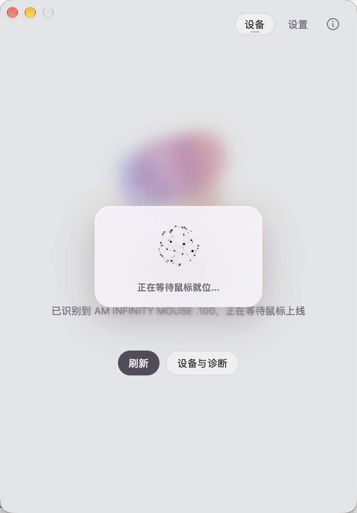

# Mira 设备稳定性真机验证与剩余风险推进

## 0. 结论

- 阶段一 `fix/device-stability-stage1` 提交：`e2e58874`。
- 真机：AM INFINITY MOUSE .100（接收器 `VID 0x3151 / PID 0x5007`），macOS 27.2。
- 真机确认有效：**burst 期间强制 Full 不再被降级**；**迟到的初始化空快照不再覆盖新事件**。
- 真机未能确认：`device_select` 乱序（只有一个匹配设备，无法切换）；真实拔插 `Clear`；`refresh_devices()` 失败分支（无法安全制造枚举失败）。
- 新发现并已修复：**首屏空白 / 只剩背景**。根因是 `thinking-orbs` 嵌套依赖携带 React 18，与宿主 React 19 形成双运行时，`ThinkingOrb` 调用另一份 React 的 hooks，dispatcher 为 null。
- 仍未修复：等待页整体遮蔽接收器功能、`mouse_ready` 可能保持旧值、多 HID 接口并列场景。

## 1. 真机环境

- `hidutil list` 显示设备 3 个 HID 接口：
  - UsagePage 1 / Usage 2（鼠标输入）
  - UsagePage 12 / Usage 1（消费类）
  - UsagePage 65535 / Usage 2（厂商控制）
- 插件 `devices.json` 的接收器描述匹配 `65535/2`；运行日志稳定为 `matched 1 device(s)`。
- 另两个接口不匹配当前插件描述，因此**没有出现多设备污染**。
- 原始输出：[mira-hid-3151.txt](evidence/mira-device-stability/mira-hid-3151.txt)

## 2. 三项修复的真机验证

### 2.1 burst 期间 Full 不被降级：PASS（真机）

方法：鼠标自然休眠使 `receiverIdle.mouseOnline=false`；调试构建通过 `MIRA_DIAG_AUTO_OFFLINE_REFRESH_MS` 在检测到 `mouse_ready=false` 后调用与 `device_refresh` 相同的路径（`reset_all_backoff` + `request_refresh_with_plan(Full)` + 唤醒读取线程）。

关键日志摘录（[mira-burst-real.log](evidence/mira-device-stability/mira-burst-real.log)）：

```text
[mira-diag] injected BatteryOnly (mouse_ready=Some(true))
[mira-diag] plan=BatteryOnly connected=true burst=false mouse_pending=false forced=Some(BatteryOnly)
[mira-diag] emit device-updated name=AM INFINITY MOUSE .100 mouse_ready=Some(false)
[mira-diag] plan=Quick connected=true burst=true mouse_pending=true forced=None
[mira-diag] injected Full (mouse_ready=Some(false))
[mira-diag] plan=Full connected=true burst=true mouse_pending=true forced=Some(Full)
[mira] plugin workflow protocol-a-receiver-read: 5 outputs: [receiverFirmwareLed, receiverFirmwareSoc, receiverFirmwareUsb, receiverIdle, receiverLighting]
[mira-diag] outcome=ready entries=1 fresh=1 names=["AM INFINITY MOUSE .100"]
```

结论：`burst=true` 时 `plan=Full`，不再被旧逻辑改成 Quick；读取实际执行并产出快照。
限制：鼠标休眠时插件按 `skipIfZero` 只执行接收器相关 5 个输出，因此这是接收器范围内的完整读取，不是鼠标参数完整读取。鼠标被物理唤醒后的 14 输出补全未能复测（见第 5 节）。

### 2.2 迟到初始化快照不覆盖新事件：PASS（真机 + 注入延迟）

方法：调试构建延迟 `device_snapshots` 响应 5.5s，并延迟读取线程启动 3s，使初始化请求先捕获空列表；随后真实设备事件到达；最后才返回空响应。

关键日志（[mira-order-green.log](evidence/mira-device-stability/mira-order-green.log)）：

```text
[mira-diag] device_snapshots response entries=0 names=[] mouse_ready=[]
[mira-diag] emit device-updated name=AM INFINITY MOUSE .100 mouse_ready=None
[mira-diag] emit device-updated name=AM INFINITY MOUSE .100 mouse_ready=Some(false)
```

延迟空响应返回后，界面仍停留在“等待鼠标就位”页，而不是回退到“未找到设备”空态：


限制：延迟由调试构建注入，设备数据本身来自真实设备；生产构建没有该延迟。

### 2.3 `device_select` 乱序：BLOCKED（真机）

- 当前只有一个匹配设备，UI 不渲染“切换鼠标”入口，无法在真机执行设备切换。
- 日志证据：`matched 1 device(s)`（[mira-burst-real.log](evidence/mira-device-stability/mira-burst-real.log)）。
- 该守卫仅有单元测试覆盖：[App.device-race.test.tsx](../../src/App.device-race.test.tsx) 的第二个用例；不能写成真机通过。

### 2.4 真实断开 `Clear` / 枚举失败 `PreserveLast`

- 鼠标休眠不是断开：真机日志中 `matched` 仍为 1，`mouse_ready=false`，结果为 `outcome=ready`，**没有** `outcome=clear`。
- 真实拔插未执行：无法物理拔掉接收器，因此 `DeviceReadOutcome::Clear` 未在真机验证。
- `refresh_devices()` 枚举失败未执行：macOS 本地枚举无法在不破坏系统的前提下稳定注入失败；仅有单元测试 `transient_enumeration_failure_preserves_last_snapshot`。

## 3. 新缺陷：首屏空白（red → green）

### 3.1 Red

调试构建启动后 WebView 空白，仅保留窗口背景与标题栏按钮。前端信标记录：

```text
[mira-diag] frontend event=mounted detail=None
[mira-diag] frontend event=window-error detail=Some("null is not an object (evaluating 'T.current.useRef')
@tauri://localhost/assets/react-vendor-CCosFbUU.js:9:43095
M@tauri://localhost/assets/runtime-data-cache-ClcH_MJQ.js:1:15424 ...")
```

证据：[mira-beacon.log](evidence/mira-device-stability/mira-beacon.log)、[mira-reactfix.log](evidence/mira-device-stability/mira-reactfix.log)。

### 3.2 根因

- 宿主：`node_modules/react` 版本 `19.2.8`。
- `thinking-orbs` 的 git 依赖自带嵌套 `node_modules/react` 版本 `18.3.1`。
- Vite 解析到两份 React；`ThinkingOrb` 调用 React 18 的 `useRef`，但渲染由 React 19 驱动，React 19 的 dispatcher 对 React 18 的 hooks 为 null，运行时异常导致首屏空白。
- 这不是 CSS/vibrancy 问题；禁用 vibrancy 后仍空白。

### 3.3 Green

修复：

- [vite.config.ts](../../vite.config.ts)：`resolve.dedupe: ['react', 'react-dom', 'react/jsx-runtime']`，并新增单一 `react-vendor` manualChunk。
- 修复后构建产物只有 `react-vendor-BNmTiJ-I.js` 包含 React 运行时符号；不再出现第二份 React。

验证：

- 启动日志只有 `frontend event=mounted`，无 `window-error`：[mira-green.log](evidence/mira-device-stability/mira-green.log)。
- 界面正常渲染“等待鼠标就位”页：[awaiting-mouse-fixed.png](evidence/mira-device-stability/awaiting-mouse-fixed.png)。

## 4. 剩余风险推进状态

| 风险 | 状态 | 证据 / 说明 |
|---|---|---|
| 首屏空白/只剩背景 | **已修复** | 双 React 运行时；真机 red→green |
| 等待页遮蔽接收器功能 | **已确认真机存在，未修复** | [installed-awaiting.png](evidence/mira-device-stability/installed-awaiting.png)；鼠标离线时接收器灯光/电量不可操作，需要产品决定是否改为“接收器可见 + 鼠标控制只读” |
| `mouse_ready` 旧值滞留 | 观察到的风险，未修复 | 已安装旧版在鼠标被唤醒后仍停留在等待页；新版 Full 读取能看到 `mouse_ready=true`。未做受控唤醒复测 |
| 多 HID/多设备污染 | 部分验证 | 3 个 HID 接口，仅 1 个匹配；未测试“直连 + 接收器同时在线” |
| 插件仓库 | 通过，无需改动 | `mira-mouse-plugins` 的 `npm test`：64 passed；AMaster 真机在线读取 14 outputs，离线读取 5 outputs |
| 完整 CI | 部分执行 | `check:quick`、`cargo test`、clippy、boundaries、structured、plugin-contract 均通过；`local-ci.sh` 未执行（含 `xtask plugins sync --locked` 下载与完整 workspace 构建） |
| 真实拔插 | BLOCKED | 需要物理拔掉接收器 |
| 设备切换乱序 | BLOCKED | 只有一个匹配设备 |

## 5. 仍未验证项与原因

1. 鼠标物理唤醒后的 14 输出补全：鼠标当前处于休眠，软件无法唤醒；需要用户移动/按键唤醒。
2. 真实拔插：需要用户物理拔掉/插回接收器；当前无法执行。
3. `refresh_devices()` 失败分支：无法安全制造 macOS HID 枚举失败；仅单元测试。
4. 设备切换：需要第二个真实匹配设备（或直连 + 接收器同时在线）。
5. 等待页遮蔽修复：需要产品确认接收器功能可见性与鼠标写入只读边界。
6. 完整 `local-ci.sh`：`xtask plugins sync --locked` 需要下载已发布插件资产；本阶段未触发网络下载。
7. 标准 `tauri build` 的 `beforeBuildCommand` 在本工作区失败：`check-local-ai-assets.mjs` 报 “Local AI handler pack identity, API, minimum runtime or publisher is invalid.”。本次 debug 真机验证使用 `--config` 覆盖 `beforeBuildCommand` 跳过该预检，**不代表发布构建通过**；该本地 AI 资源问题未修复。

## 6. 分支与测试

- 分支：`fix/device-stability-stage1`
- 阶段一提交：`e2e58874`
- 真机验证/修复提交：见 `git log`（本报告与证据同提交）
- 前端：`npm run check:quick` → lint/typecheck/**574 tests passed**/fmt/diff-check 通过
- Rust：`cargo test -p mira-app --lib` → **574 passed; 0 failed**
- Rust lint：`cargo clippy -p mira-app --lib --locked -- -D warnings` → 通过
- 架构/结构/插件契约：`check:boundaries`、`check:structured`、`check:plugin-contract` → 通过
- 插件仓库：`npm test` → **64 passed**
- 前端构建：`npm run build` → 通过，产物只含单一 React 运行时
- 未 push、未合并 `main`、未触发远程 Action
